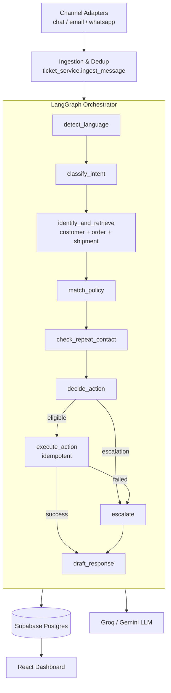

# Multilingual Order Support Copilot Agent (PS-14)

An autonomous, multi-agent customer support resolution system for e-commerce.
It ingests customer messages from chat, email, and WhatsApp in English,
Hindi, and Marathi (including Romanized and code-mixed text), retrieves live
order/shipment data, matches the situation against versioned support
policies, decides and executes the correct next action, escalates what
genuinely needs a human, and replies in the customer's own language — with a
full audit trail for every decision.

## Why this is agentic AI, not a chatbot

A naive system does:

```
customer message → LLM → generated reply
```

This system does:

```
understand → retrieve → reason → decide → act → verify → respond
```

Every ticket moves through a **LangGraph** state machine where each node is a
discrete agent responsibility (language detection, intent classification,
order retrieval, policy matching, decision, execution, escalation, response
drafting). The LLM is used only where judgment over natural language is
needed (language/intent understanding, reply drafting). **Every
financial/customer-impacting action (refund, credit, return) is gated by
deterministic policy checks in code** — the LLM is never trusted to decide
whether money moves. See `backend/app/agents/nodes.py` and
`backend/app/services/policy_service.py`.

## Architecture



### Multi-agent responsibilities

| # | Agent | Implementation |
|---|-------|-----------------|
| 1 | Omnichannel Ingestion | `POST /tickets` + `ticket_service.ingest_message` (channel adapters are simulated via the request payload; dedup by thread+text+time window) |
| 2 | Language Detection & Translation | `services/language_service.py` — heuristic (Devanagari + Romanized marker words) first, LLM fallback for ambiguous/code-mixed text |
| 3 | Intent Classification | `agents/nodes.py:intent_node` — LLM structured output with confidence + multi-intent flag |
| 4 | Order Data Retrieval | `services/order_service.py` — queries Supabase, normalizes ETA/delay/timestamps |
| 5 | Policy & FAQ Matching | `services/policy_service.py` — deterministic rule evaluation against versioned `policies` table |
| 6 | Action Decision | `agents/nodes.py:decision_node` — risk-gated routing (confidence threshold, multi-intent conflict, repeat contact, policy eligibility) |
| 7 | Action Execution | `services/action_service.py` — idempotent execute against simulated refund/credit/return "backend systems" |
| 8 | Escalation | `agents/nodes.py:escalation_node` — builds a full handoff summary so a human never re-investigates from scratch |
| 9 | Multilingual Response Drafting | `agents/nodes.py:response_node` — grounded reply in customer's language/script, with deterministic template fallback |
| 10 | Orchestrator | `agents/graph.py` + `services/ticket_service.py` — LangGraph wiring, retries, persistence, audit logging |

## Tech stack

- **Frontend:** React 19 + Vite + Tailwind CSS + Recharts + React Router
- **Backend:** Python + FastAPI
- **Agent orchestration:** LangGraph (`StateGraph`)
- **Database/Auth:** Supabase (Postgres + Row Level Security + Auth), pgvector extension enabled (available for future semantic FAQ retrieval)
- **LLM:** Groq (`llama-3.3-70b-versatile`) or Gemini — provider is swappable via `LLM_PROVIDER`
- **Testing:** pytest, with a hand-rolled in-memory fake Supabase client so tests never touch the network
- **Containerization:** Dockerfiles + docker-compose for both services

## Database design

See `supabase/migrations/0001_init.sql` for the full schema. Key tables:

- `customers`, `orders`, `order_items`, `shipment_events`, `payments` — the simulated e-commerce backend
- `policies` — versioned, auditable support rules with machine-checkable `conditions` (JSON) plus `embedding vector(768)` for future semantic retrieval
- `tickets` — the unified cross-channel ticket schema
- `ticket_events` — per-step pipeline trail (language → intent → order_lookup → policy_match → decision → action_execution/escalation → response_drafting)
- `actions` — executed actions with a **unique `idempotency_key`** so retries/duplicate webhooks never double-refund
- `escalations` — human handoff queue with a full JSON context summary
- `audit_log` — flattened event stream for compliance export
- `contact_history` — repeat-contact memory per customer+order
- `staff_profiles` — role (`agent` / `supervisor` / `admin`) layered on top of Supabase Auth users

RLS is enabled on every table; the backend uses the Supabase **service_role**
key (bypasses RLS, backend-only, never shipped to the frontend) after
authenticating the staff member's JWT and checking their role via
`core/security.py`.

## Autonomy safeguards

- **Deterministic policy gate** before any money moves (`policy_service.match_policy`) — the LLM only feeds intent/language, never the eligibility decision.
- **Idempotency keys** (`"{ticket_id}:{action_type}"`) on every action row — a retried or duplicate-delivered ticket can never execute the same refund/credit twice (`test_action_service.py` proves this).
- **Confidence-gated autonomy** — intent confidence below `INTENT_CONFIDENCE_AUTO_THRESHOLD` always escalates, regardless of intent.
- **Multi-intent conflict detection** escalates rather than guessing.
- **Repeat-contact memory** — 3+ unresolved contacts on the same order force escalation even if the individual message looks routine.
- **High-value cap** — refunds above `REFUND_AUTO_APPROVE_MAX_INR` always require a human.
- **Grounded responses only** — the response-drafting prompt is given explicit grounding facts and instructed never to invent status/amounts; a deterministic template fallback runs if the LLM is unavailable or returns malformed JSON.
- **Retry + fallback on failure** — one retry on order-lookup failure, LLM calls retry once then fall back to heuristics/templates, execution failures route to escalation instead of a false-success reply.

## Repository layout

```
backend/
  app/
    agents/       # LangGraph state, nodes, graph wiring
    api/          # FastAPI routers (auth, tickets, dashboard, policies)
    core/         # settings, JWT/Supabase auth dependency
    db/           # Supabase client factories
    schemas/      # Pydantic request/response models
    services/     # order/policy/action/language/contact/llm/ticket services
  seed/            # demo data seeder
  tests/           # pytest suite + fake Supabase client fixture
frontend/
  src/
    pages/         # Overview, TicketQueue, TicketDetail, Escalations, Policies, AuditHistory, Simulate, Login
    components/    # Layout, StatusChip
    lib/           # api client, auth context
supabase/
  migrations/      # 0001_init.sql
docker-compose.yml
.env.example
```

## Setup

### 1. Supabase project

1. Create a project at https://supabase.com/dashboard.
2. In the SQL editor, run `supabase/migrations/0001_init.sql`.
3. Project Settings → API: copy the **Project URL**, **anon public key**, and **service_role key**.
4. Authentication → Providers: ensure Email provider is enabled.
5. Authentication → Users: create 1-2 demo users (e.g. `agent@demo.com`, `supervisor@demo.com`) with passwords you choose.
6. SQL editor: insert their staff profiles —
   ```sql
   insert into staff_profiles (id, full_name, role) values
     ('<agent-user-uuid>', 'Demo Agent', 'agent'),
     ('<supervisor-user-uuid>', 'Demo Supervisor', 'supervisor');
   ```
   (Find each UUID in Authentication → Users.)

### 2. Environment variables

```
cp .env.example backend/.env
cp frontend/.env.example frontend/.env
```

Fill in `backend/.env`:
- `SUPABASE_URL`, `SUPABASE_ANON_KEY`, `SUPABASE_SERVICE_ROLE_KEY` — from step 1.
- `GROQ_API_KEY` (https://console.groq.com/keys) and/or `GEMINI_API_KEY` (https://aistudio.google.com/app/apikey). Set `LLM_PROVIDER=groq` or `gemini`.
- `JWT_SECRET` — any long random string (used only as a placeholder; actual auth tokens are Supabase's own JWTs, verified via the Supabase SDK).
- Business thresholds (`DELAY_COMPENSATION_INR`, `REFUND_AUTO_APPROVE_MAX_INR`, etc.) have sensible demo defaults — override if you want different thresholds.

`frontend/.env` just needs `VITE_API_BASE_URL=http://localhost:8000`.

### 3. Backend

```bash
cd backend
python -m venv .venv
source .venv/Scripts/activate   # Windows Git Bash; use .venv/bin/activate on macOS/Linux
pip install -r requirements.txt
python -m seed.seed_data        # seeds customers/orders/policies/etc.
uvicorn app.main:app --reload
```

Visit http://localhost:8000/health — it reports whether Supabase and the LLM
provider are configured.

### 4. Frontend

```bash
cd frontend
npm install
npm run dev
```

Visit http://localhost:5173, sign in with the demo user(s) created above.

### 5. Docker (alternative)

```bash
docker compose up --build
```

## Testing

```bash
cd backend
source .venv/Scripts/activate
python -m pytest -q
```

43+ tests cover: policy eligibility logic, idempotent action execution
(including the duplicate-prevention guarantee), language heuristics
(Devanagari/Romanized Hindi/Marathi/English/code-mixed), decision routing for
every escalation trigger, order retrieval and delay-flagging, message dedup,
repeat-contact thresholds, API auth (401 without a token) and role
permissions (403 for agent on supervisor-only `retry`), and two full
LangGraph end-to-end runs (delayed order → auto credit path; order-not-found
→ escalation path) with the LLM mocked out so tests never need network
access. All services are tested against a hand-rolled in-memory fake
Supabase client (`tests/conftest.py`) rather than a live database.

## Demo credentials

Provisioned by you in Supabase Auth per the Setup section above (there is no
hardcoded demo account, since Supabase owns authentication). Suggested:

- `agent@demo.com` / your chosen password — role `agent`
- `supervisor@demo.com` / your chosen password — role `supervisor` (can retry failed/escalated tickets)

## Demo flow for evaluation

1. **Login** as the supervisor account.
2. **Overview** — show the metrics dashboard (empty initially).
3. **Simulate Message** page — click through the 8 preset scenarios one at a
   time; each fires `POST /tickets` through the full pipeline synchronously:
   - Hindi/Hinglish delayed delivery → auto delay credit, Hindi reply
   - English order tracking → reply-only
   - Wrong item + refund → auto refund (low value)
   - Marathi return request → auto return initiation
   - High-value refund → escalates (order value over cap)
   - Order not found → escalates with a clear reason
   - Ambiguous/cancelled-order delay claim → escalates (policy doesn't cleanly apply)
   - Repeat contact → escalates due to contact-history threshold
4. **Ticket Queue** — show the resulting tickets, filter by status/channel.
5. **Ticket Detail** on the Hindi delay example — walk through the pipeline
   trail (language → intent → order retrieval → policy match → decision →
   action execution → response), which is the page that makes the "why
   agentic" argument visually obvious.
6. **Escalation Queue** — show the handoff summaries that let a human skip
   re-investigation.
7. **Policies** — show the versioned, auditable rules behind every decision.
8. **Audit History** — export the CSV audit trail.
9. Re-run the same Hindi message **twice in a row** to demonstrate dedup, and
   re-submit a resolved ticket via "Retry pipeline" (supervisor-only) to show
   idempotent action execution doesn't double-credit.

## Known limitations

- Channel adapters (WhatsApp Business API, real email inbox, chat widget)
  are simulated via a single normalized `POST /tickets` endpoint rather than
  wired to live third-party webhooks — swapping in real webhook handlers
  that call `ticket_service.ingest_message` is the only change needed.
- Policy semantic retrieval via pgvector is schema-ready (`policies.embedding`)
  but not populated/used yet; matching is currently fully deterministic,
  which is intentional for auditability but means free-text FAQ matching
  beyond the 7 seeded categories isn't covered.
- The pipeline runs synchronously per request for demo simplicity; a
  production system would queue ingestion and process asynchronously.
- Policy-version-diff awareness (flagging tickets resolved under a
  superseded policy) has schema support (`superseded_by`, `version`) but no
  dedicated background job yet.

## Future improvements

- Background worker + queue for async ticket processing at scale.
- Populate `policies.embedding` and add a semantic FAQ-matching node for
  free-text queries that don't map to a clean category.
- Real channel webhook adapters (WhatsApp Business API, IMAP/SMTP, chat SDK).
- Scheduled job for proactive delay notifications (query orders past ETA with
  no ticket yet, draft and queue outbound messages).
- Policy-version-diff job to flag tickets resolved under policies changed in
  the last 24 hours.
